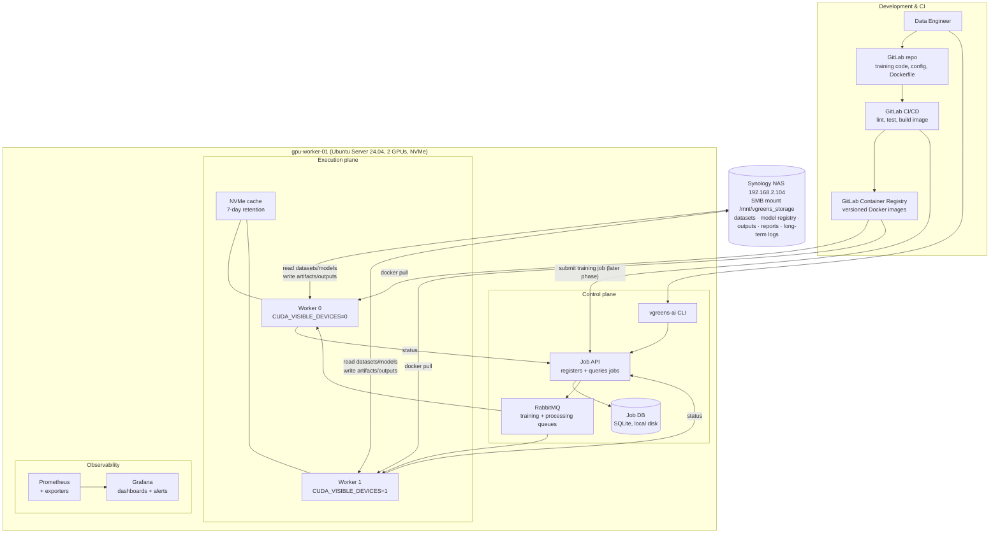
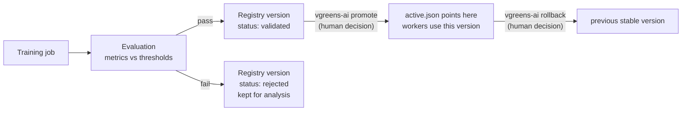

# vGreens AI Platform — Design Document

GPU-based training and processing platform for vGreens: train models, validate
them, promote only validated versions, and run production processing on GPU
workers — on our own hardware, NAS-centric, GitLab-driven.

Status: **DRAFT rev 2** · Author: Achref · Date: 2026-07-02

**Scope boundary:** this platform is **standalone**. It does not depend on,
integrate with, or require the vGreensLab webapp or its team. The only
interfaces are the `vgreens-ai` CLI, the Job API, and server-side tooling.
Webapp integration is explicitly out of scope until the platform is proven.

---

## 1. The platform in one page

A data engineer pushes training code to GitLab and launches jobs with the
`vgreens-ai` CLI. Every job — training or processing — follows **one single
path**: it is registered in a small job database, published to RabbitMQ, and
picked up by a GPU worker (one worker pinned per GPU). Training jobs copy
their dataset version from NAS to local NVMe, train inside Docker, run
evaluation, and write a versioned model artifact to the NAS model registry
with status `validated` or `rejected`. Nothing reaches production
automatically: a human promotes a validated version with one CLI command,
which atomically flips a pointer file. Processing jobs load whatever version
the pointer names, read inputs from NAS, write outputs to NAS per tenant.
If a promoted model misbehaves, one CLI command rolls the pointer back to the
previous stable version. Rejected and superseded models are never deleted.
The NAS is the source of truth for everything durable; the GPU machine keeps
only temporary cache.



Promotion lifecycle (separate, deliberately manual):



## 2. Infrastructure baseline (decided)

| Item | Decision |
|---|---|
| Machine | existing GPU computer, currently Windows — **backup check with team, then wipe** |
| OS | Ubuntu Server 24.04 LTS |
| Hostname / user | `gpu-worker-01` / `vgreens` |
| Network | wired Ethernet, same LAN as NAS; static IP or DHCP reservation (e.g. `192.168.2.50`; NAS `192.168.2.104`) |
| Access | OpenSSH from approved internal/admin networks only; **no public exposure** of GPU machine or NAS |
| NAS mount | SMB/CIFS `//192.168.2.104/vGreens_Storage` → `/mnt/vgreens_storage`, permanent via fstab |
| Runtime | **Docker + NVIDIA container toolkit** (chosen over venvs: reproducible, per-model isolation, aligns with GitLab image builds) |
| Local storage role | temporary cache only (NVMe), 7-day retention, auto-cleaned; NAS is the single source of truth |
| Monitoring | **Prometheus + Grafana** on the GPU server |

fstab line (reference):

```text
//192.168.2.104/vGreens_Storage  /mnt/vgreens_storage  cifs  credentials=/etc/vgreens/.nas-credentials,uid=vgreens,gid=vgreens,vers=3.0,iocharset=utf8,nofail,_netdev  0  0
```

`nofail` + `_netdev`: the machine boots cleanly even if the NAS/network is
down and remounts when available. Credentials live in a root-owned file, not
in fstab. Workers must **check the mount is alive before every job** (a
stat on a marker file) and fail the job cleanly if the NAS is absent —
never write outputs locally as a fallback.

GPU runtime validation sequence: `nvidia-smi` on the host → then
`docker run --rm --gpus all nvidia/cuda:12.4.1-base-ubuntu24.04 nvidia-smi`.

One SMB note: the registry's `active.json` is updated via write-temp +
`rename()`, which SMBv3 handles atomically enough for a single-writer
pattern (only the Job API ever writes it). The SQLite job DB stays on the
**local disk**, never on the SMB mount (SQLite + network filesystems is a
known corruption trap).

## 3. The three structural gaps fixed vs the original sketch

**Gap 1 — no job state store.** RabbitMQ is a transport, not a database: once
a worker consumes a message, nobody can answer "what's the status of job X?".
Fix: a small **Job API + SQLite DB** on the GPU server. The CLI (and later
CI) talk to the API; the API writes the job record, publishes to RabbitMQ,
and workers report status transitions back to it.

**Gap 2 — two competing execution paths.** GitLab CI "starting training"
directly on the GPU machine would fight the queue workers for the same two
GPUs. Fix: **everything is a queue job.** CI builds and validates images,
then (in a later phase) *submits* a training job through the same API the
CLI uses. Workers are the only thing that ever touches a GPU.

**Gap 3 — no model-agnostic contract.** "Works for more than one model"
requires the platform to know nothing about YOLO/torch/etc. Fix: the
**container contract** (section 6): the platform runs *any* image that
respects agreed mounts, env vars, and output layout. New model family = new
repo from a template, zero platform changes.

Smaller decisions: CI never moves model files (workers write the registry
directly) · `active.json` pointer file instead of NAS symlinks (SMB-safe,
atomic) · rollback stays **manual** (alert → human runs one command;
auto-rollback only after a health signal is proven trustworthy) · Docker
images live in GitLab's built-in Container Registry.

## 4. Components and responsibilities

| Component | Runs on | Responsibility |
|---|---|---|
| `vgreens-ai` CLI | engineer machines / gpu-worker-01 | submit/inspect jobs, promote, rollback — thin client over the Job API |
| Job API (FastAPI, small) | gpu-worker-01 | validate requests, own the job DB, publish to RabbitMQ, receive worker status, expose job/model queries, write `active.json` |
| Job DB (SQLite) | gpu-worker-01 local disk | source of truth for job state and history |
| RabbitMQ (Docker) | gpu-worker-01 | `training_jobs` + `processing_jobs` quorum queues, retries, dead-letter |
| Worker 0 / Worker 1 (systemd) | gpu-worker-01 | consume jobs, pin one GPU each, verify NAS mount, stage NVMe cache, run job containers, write artifacts/outputs to NAS, report status |
| NVMe cache manager (in worker) | gpu-worker-01 | dataset/model staging NAS→NVMe, checksum verify, 7-day + low-space eviction |
| NAS | Synology | datasets (immutable versions), model registry, processing outputs, reports, long-term logs |
| Model registry (files + pointer) | NAS | versioned artifacts, `active.json`, `promotions.jsonl` history |
| GitLab repo + CI + Container Registry | GitLab | code, review, lint/test, image build; job submission in a later phase |
| Prometheus + exporters | gpu-worker-01 | scrape node, GPU, RabbitMQ, Job API, health-check metrics |
| Grafana | gpu-worker-01 | dashboards + alerting |

## 5. Storage layouts

### NAS (`/mnt/vgreens_storage/ai/`)

```text
ai/
  datasets/
    tomato_detection/
      versions/
        v1/
          images/
          labels/
          metadata.json        # frozen: true, checksums, counts, source
        v2/ ...
  model_registry/
    tomato_detector/
      versions/
        2026-07-02_001/
          model.pt
          metadata.json
          config.yaml
          requirements.txt
          evaluation_report.md
          status.json          # validated | rejected (+ reason)
        2026-07-02_002/ ...
      active.json              # atomic pointer (no symlinks on SMB)
      promotions.jsonl         # append-only promote/rollback history
  jobs/
    2026/
      <job_id>/
        job.json               # submitted payload snapshot
        logs/worker.log
        logs/container.log
        eval/                  # metrics.json, plots
  processing/
    frutania/
      tomato_detector/
        2026-07-02/<job_id>/
          results.csv
          report.json
```

Rules: dataset versions are **immutable once frozen** (metadata.json carries
`frozen: true` + checksums) · tenant always appears in processing paths ·
nothing under `model_registry/` is ever deleted, only status-changed · NAS is
the source of truth for datasets, artifacts, registry, outputs, reports, and
long-term logs.

### NVMe cache (local, temporary only)

```text
/nvme/
  cache/
    datasets/<name>/<version>/   # rsync'd from NAS, .complete marker
    models/<model>/<version>/    # staged active model for processing
  jobs/<job_id>/scratch/         # checkpoints, tmp — wiped after upload
```

Cache policy: staged on miss (rsync, bandwidth-capped so the NAS isn't
saturated), verified against metadata checksums, `.complete` marker written
last. Cleanup: anything untouched for **7 days** is deleted by a daily
systemd timer; additionally evict LRU when free space < 15%. Nothing in
`/nvme` is ever the only copy of anything.

## 6. The container contract (the key abstraction)

The platform runs any Docker image that obeys this contract — this is what
makes it model-agnostic:

```text
Mounts (read-only unless noted):
  /data              dataset (NVMe cache for training; NAS input for processing)
  /config/job.yaml   the job config (from repo or CLI)
  /model             active model artifact dir (processing jobs only)
  /out               writable — everything the job wants to keep

Env:
  JOB_ID, JOB_TYPE (training|processing), MODEL_NAME, DATASET_VERSION,
  TENANT (processing); GPU visibility already constrained by the worker

Exit code: 0 = success, non-zero = failure (worker captures logs either way)

Training jobs must leave in /out:
  model file(s), metadata.json (partial — worker completes it),
  eval/metrics.json, evaluation_report.md
Processing jobs must leave in /out:
  results (csv/json/images), report.json (summary counts, errors)
```

The worker — not the job code — decides where `/out` lands on NAS, completes
metadata (git commit, image digest, dataset version, duration, GPU), compares
`eval/metrics.json` against thresholds from the model config, and writes
`status.json` (validated/rejected). Job code stays simple and framework-free.

## 7. Model artifact & metadata spec

`metadata.json` (final, worker-completed):

```json
{
  "model_name": "tomato_detector",
  "version": "2026-07-02_002",
  "git_commit": "abc123",
  "docker_image": "registry.gitlab.com/vgreens/tomato:sha-abc123",
  "docker_image_digest": "sha256:…",
  "dataset": "tomato_detection",
  "dataset_version": "v2",
  "trained_at": "2026-07-02T14:03:00Z",
  "author": "achref",
  "job_id": "trn_20260702_a1b2",
  "hardware": "GPU model, CUDA version, driver version",
  "duration_seconds": 8423,
  "metrics": { "mAP50": 0.91, "precision": 0.93, "recall": 0.88 },
  "thresholds": { "mAP50": 0.85 },
  "validation_status": "validated",
  "notes": ""
}
```

`active.json` (per model, atomic write by the Job API only):

```json
{
  "model_name": "tomato_detector",
  "active_version": "2026-07-02_002",
  "previous_stable": "2026-07-02_001",
  "promoted_by": "achref",
  "promoted_at": "2026-07-03T09:00:00Z"
}
```

Every promote/rollback appends one line to `promotions.jsonl` (who, when,
from→to, reason) — that file *is* the audit trail.

Version status lifecycle: `rejected` (terminal, archived) · `validated` →
may become the version named by `active.json` → superseded versions keep
status `validated` and remain instantly rollback-able.

## 8. Job payload & DB schema

Queue message (JSON):

```json
{
  "job_id": "trn_20260702_a1b2",
  "job_type": "training",
  "model_name": "tomato_detector",
  "dataset": "tomato_detection",
  "dataset_version": "v2",
  "config_path": "configs/tomato.yaml",
  "docker_image": "registry.gitlab.com/vgreens/tomato:sha-abc123",
  "tenant": null,
  "requested_by": "achref",
  "priority": 5,
  "created_at": "2026-07-02T13:00:00Z"
}
```

(Processing jobs: `tenant` set, `input_path` instead of dataset version.)

Job DB (SQLite, local disk), one table to start:

```sql
CREATE TABLE jobs (
  job_id TEXT PRIMARY KEY,
  job_type TEXT NOT NULL,            -- training | processing
  model_name TEXT NOT NULL,
  dataset TEXT, dataset_version TEXT,
  tenant TEXT,
  docker_image TEXT,
  config_path TEXT,
  status TEXT NOT NULL,              -- queued|running|succeeded|failed|cancelled
  worker TEXT, gpu INTEGER,
  requested_by TEXT,
  priority INTEGER DEFAULT 5,
  created_at TEXT, started_at TEXT, finished_at TEXT,
  error TEXT,
  output_path TEXT,                  -- NAS location of results/artifact
  result_version TEXT                -- registry version produced (training)
);
```

Datasets, model versions, evaluations, promotions are **files on NAS** — no
second database. The DB tracks *jobs*; the NAS tracks *artifacts*.

## 9. Queueing & reliability

- Two quorum queues: `training_jobs`, `processing_jobs`. Workers consume
  **both** with `prefetch=1` (one job at a time per GPU).
- Concurrency policy: **at most one training job at any time** — enforced by
  a training lock in the Job API, so one GPU always stays free for
  processing.
- Ack only after completion; worker crash ⇒ message requeues; RabbitMQ
  `delivery-limit` (3) dead-letters poison jobs to `failed_jobs`; the API
  marks them `failed` with the last error.
- Workers are systemd template units — `vgreens-worker@0`,
  `vgreens-worker@1` — with `Environment=CUDA_VISIBLE_DEVICES=%i`,
  `Restart=always`. GPU isolation is structural, not conventional.
- Every worker run starts with preflight checks: NAS mount alive, Docker up,
  GPU visible, disk/NVMe space above floor — fail fast and report otherwise.

## 10. CLI spec (thin client over the Job API)

```bash
vgreens-ai train   --model tomato_detector --dataset tomato_detection:v2 \
                   --config configs/tomato.yaml [--image <tag>] [--priority N]
vgreens-ai process --model tomato_detector --input <nas_path> --tenant frutania
vgreens-ai status  --job-id <id>            # state, timing, worker, output path
vgreens-ai logs    --job-id <id> [--follow]
vgreens-ai list-jobs [--status running] [--model X] [--mine]
vgreens-ai models                            # registry overview + active versions
vgreens-ai promote  --model tomato_detector --version 2026-07-02_002
vgreens-ai rollback --model tomato_detector [--to <version>] --reason "…"
vgreens-ai datasets [--model X]
```

Config: `~/.vgreens-ai.toml` (API URL + token). The CLI never talks to
RabbitMQ or the NAS directly — everything goes through the API.

## 11. Repository structure

```text
vgreens-ai-platform/          # one repo: the platform itself
  api/          # FastAPI job API
  worker/       # consumer, cache manager, container runner, evaluator glue
  cli/          # vgreens-ai
  deploy/       # docker-compose (rabbitmq, prometheus, grafana), systemd units,
                # fstab/install notes, health-check script
  docs/

vgreens-model-template/       # cloned per model family
  src/                        # training + inference code
  configs/<model>.yaml        # incl. eval thresholds
  Dockerfile
  requirements.txt
  entrypoint.sh               # implements the container contract
  .gitlab-ci.yml
```

## 12. Monitoring plan (Prometheus + Grafana)

Exporters on gpu-worker-01, all scraped by a local Prometheus:

- `node_exporter` — CPU, RAM, disks (root + NVMe), network
- NVIDIA GPU exporter (dcgm-exporter or nvidia-smi textfile) — utilization,
  memory, temperature, per GPU
- `rabbitmq_prometheus` plugin — queue depths, consumers, connection state
- Job API `/metrics` — jobs by status, job duration, last successful
  training/processing timestamps, training-lock state, worker heartbeats
- **Health-check script** (Phase 0, systemd timer → node_exporter textfile):
  NAS mounted (marker-file stat), GPU visible, Docker responsive, NVMe/disk
  usage, cache age — these metrics exist *before* the platform does

Grafana: one board initially — jobs now/today + failures · GPU
utilization/memory per GPU · queue depths · NAS mount + disk gauges · active
model per family + last evaluation metrics.

Alerts (Grafana alerting, from day one of Phase 2):

| Alert | Condition |
|---|---|
| NAS unavailable | mount check failing > 2 min |
| GPU not detected | nvidia-smi failing / exporter absent |
| Worker stopped | heartbeat stale > 2 min |
| Queue unreachable | RabbitMQ exporter down / connections zero |
| Job failed | any job transitions to `failed` |
| Disk/NVMe high | > 85 % |
| Docker/NVIDIA runtime failure | health-check flag |

InfluxDB is **not** part of this platform's monitoring. An optional
"processed outputs → InfluxDB" sync for business data can be added later as
one more processing-job type, without touching the monitoring stack.

## 13. Implementation phases

**Phase 0 — infrastructure preparation & validation (blocking, do first)**

1. Ask the team what's on the Windows machine; back up anything needed to
   the NAS; get explicit OK to wipe.
2. Install Ubuntu Server 24.04 LTS · hostname `gpu-worker-01` · user
   `vgreens` · OpenSSH on · static IP / DHCP reservation · verify Ethernet
   to the NAS LAN.
3. NAS: create the `ai/` folder skeleton; credentials file; fstab CIFS mount
   with `nofail,_netdev`; reboot test (with NAS up **and** deliberately
   unreachable — machine must boot cleanly both times).
4. NVIDIA driver → `nvidia-smi` OK · Docker → NVIDIA container toolkit →
   `docker run --rm --gpus all … nvidia-smi` OK.
5. NVMe cache directories + 7-day cleanup timer.
6. Health-check script + systemd timer (the Phase 0 exit test is: all checks
   green, survives reboot, survives NAS outage).

**Phase 1 — minimal platform skeleton (prove the loop)**

Job API + SQLite + schema · RabbitMQ (docker-compose) · CLI with
`train/process/status/logs/list-jobs` · **one** worker (systemd, GPU 0,
prefetch=1, preflight checks) · container contract v1 + template repo · a
**dummy GPU job** (burns GPU for a minute, reads an input from NAS, writes
an output + report back to NAS) · job logs on NAS.
**Exit test:** submit dummy job from CLI → runs on GPU → output lands on
NAS → `status`/`logs` show the whole story.

**Phase 2 — production-like AI workflow**

Second worker (GPU 1) + training lock · model registry structure +
artifact spec + evaluation → validated/rejected · `promote` / `rollback` /
`models` commands · real training job for the first model family · NVMe
staging with checksums · Prometheus + Grafana + the alert set · cache
cleanup automation hardened.
**Exit test:** train a real model end-to-end, reject one on purpose,
promote a validated one, run processing against it, roll back — all from
the CLI, all visible in Grafana.

**Phase 3 — CI integration & extensions (on demand)**

GitLab CI pipeline on model repos (lint/test/build/push + manual
`submit_training_job` stage calling the Job API) · dataset freeze tooling
(`vgreens-ai dataset freeze` writing checksums/metadata) · priority
handling polish · optional InfluxDB business-data sync as a processing-job
type · defined model-health signal (→ only then discuss guarded
auto-rollback) · second GPU machine if needed (workers already speak
RabbitMQ, so scaling out is additive).

## 14. MVP checklist

MVP = Phase 0 + Phase 1 + Phase 2 as defined above. Concretely:

- [ ] Windows data checked/backed up, Ubuntu 24.04 installed and reachable
- [ ] Permanent CIFS NAS mount surviving reboots and NAS outages
- [ ] `nvidia-smi` OK on host and inside Docker
- [ ] NAS `ai/` folder structure created
- [ ] NVMe cache with 7-day auto-cleanup
- [ ] Health-check script + timer
- [ ] Job API + SQLite job store
- [ ] RabbitMQ with training/processing/failed queues
- [ ] `vgreens-ai` CLI (train, process, status, logs, list-jobs)
- [ ] Worker 0 + Worker 1 with hard GPU pinning and preflight checks
- [ ] Container contract + model template repo
- [ ] Dummy GPU job proving NAS→GPU→NAS loop
- [ ] Model registry + artifact format + evaluation reports
- [ ] Manual promotion + rollback via CLI with audit trail
- [ ] Prometheus + Grafana with the 7 baseline alerts

Explicitly **not** in MVP: webapp integration, GitLab CI job submission,
automatic promotion/rollback, InfluxDB sync, Kubernetes, cloud GPUs,
multi-node scheduling.

## 15. Risks & tradeoffs

- **Single machine = SPOF** for control plane and execution. Accepted:
  systemd everywhere, docker-compose for services, documented cold-start.
  Scale-out later is additive (workers just consume the queue).
- **SMB quirks** — no symlinks in the registry (pointer files), SQLite kept
  off the mount, single-writer rule for `active.json`, preflight mount
  checks before every job.
- **NAS saturation during staging** — bandwidth-capped rsync, stage only on
  cache miss, never train directly against the NAS.
- **NVMe fills** — 7-day TTL + low-space LRU eviction + disk alert at 85 %.
- **Long training blocking production** — one-training-at-a-time lock
  guarantees a free GPU for processing.
- **File-based registry vs MLflow** — files are transparent, NAS-native,
  zero extra services; MLflow can be layered later reading the same
  artifacts. Right trade for team size.
- **Secrets** — NAS credentials root-owned on gpu-worker-01; API tokens per
  engineer; nothing in repos.
- **Windows wipe** — irreversible; the backup check with the team is a
  formal gate, not a courtesy.

## 16. Open decisions (need answers, none block Phase 0 except #1)

1. **Windows machine contents** — who signs off that it's safe to wipe?
2. **Exact hardware** — GPU models, RAM, NVMe capacity (affects cache
   sizing and concurrent-job realism).
3. **First model family** to onboard in Phase 2 (tomato detection /
   YOLO-PyTorch?) — determines the first template image.
4. **NAS share** — dedicated `ai/` inside `vGreens_Storage` (assumed) or a
   separate share with its own quota?
5. **Who may promote/rollback** — any engineer with an API token (proposed
   for MVP) or a named approver?
6. **Retention** — job logs horizon (12 months?), never-delete policy for
   model versions confirmed against NAS capacity?
7. **Version naming** — `YYYY-MM-DD_NNN` (proposed) — confirm.
8. **RabbitMQ/Grafana exposure** — localhost-only + SSH tunnel (proposed)
   or LAN-visible with auth?

## 17. Deliberately NOT doing (anti-overengineering)

No Kubernetes (2 GPUs, one box — systemd + Docker is the right size). No
cloud GPUs. No webapp coupling. No Airflow/Kubeflow/Slurm. No automatic
promotion, no automatic rollback. No custom dataset-diff tooling (immutable
versions + checksums suffice). No microservices — one API, one worker
binary, one CLI.
